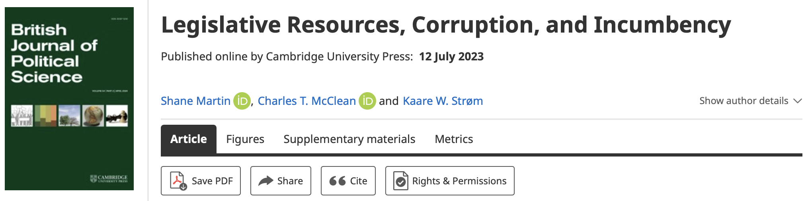

Shane Martin, Kaare Strøm, and I have a new article out in the [British Journal of Political Science](https://www.cambridge.org/core/journals/british-journal-of-political-science/article/legislative-resources-corruption-and-incumbency/FE9D6678534A0450E57C19A97A4D45FF)!

**Abstract**

Members of some legislatures enjoy long political careers, whereas elsewhere turnover is rampant. This variation is consequential since high-incumbency assemblies may facilitate legislative expertise at the expense of social representation. We explore cross-national differences in re-election (incumbency) rates by identifying ‘supply’ conditions such as legislative resources that benefit incumbents as well as ‘demand’ conditions such as political corruption that affect voters' willingness to re-elect incumbents. We hypothesize that legislative perquisites help incumbents win re-election, but only if there is relatively high public confidence in politics, as reflected in low corruption levels. We tested our argument using OLS and instrumental variable regression and new global data on sixty-eight democracies (2000–18) covering 288 elections and over 55,000 legislators. We found that legislative resources help incumbents get re-elected only under relatively low levels of political corruption. In contrast, under severe corruption, such resources can depress re-election rates.
