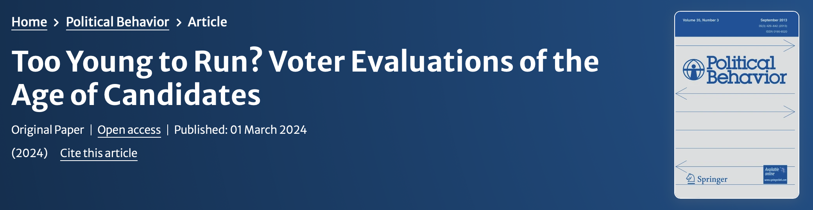

Yoshikuni Ono (Waseda University) and I have a new article out in [Political Behavior](https://link.springer.com/article/10.1007/s11109-024-09920-2)!

**Abstract**

Why do elected officials tend to be much older than most of their constituents? To understand the mechanisms behind the underrepresentation of young people in public office, we conducted two novel survey experiments in Japan. We asked voters in these experiments to evaluate the photos of hypothetical candidates while altering candidates’ faces using age regression and progression software. Contrary to the observed age demographics of politicians, the voters in our experiments strongly disliked older candidates but viewed younger and middle-aged candidates as equally favorable. Voters saw young candidates as less experienced but also more likely to focus on many policy issues over a longer period, including education, childcare, climate change, anti-corruption measures, and multiculturalism. Young voters especially liked young candidates, suggesting that greater youth turnout could increase youth representation. Conversely, elderly candidates were universally panned, seen as the least competent, least likely to focus on most policy issues, and least electable. Voter biases thus do not seem to be a driving factor behind the shortage of young politicians. To the contrary, voters appear perfectly willing to cast their ballots for young candidates.
