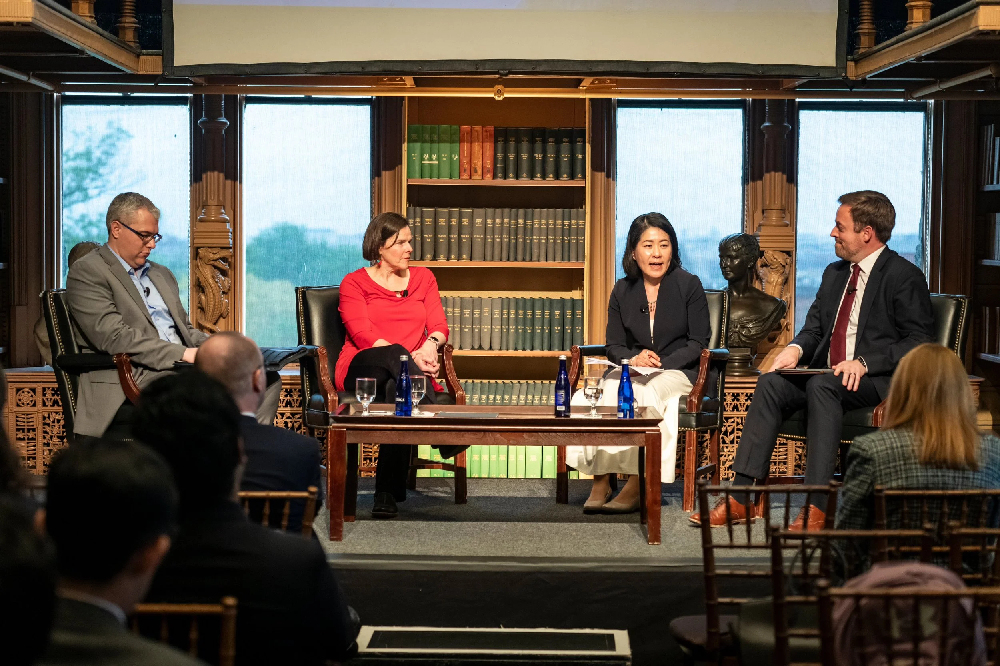

I spoke about challenges for democracy in the US and Japan at this [Georgetown conference](https://adampliff.com/wp-content/uploads/2024/04/georgetown_april-19th-us-japan-conference-flyer-png.png).
