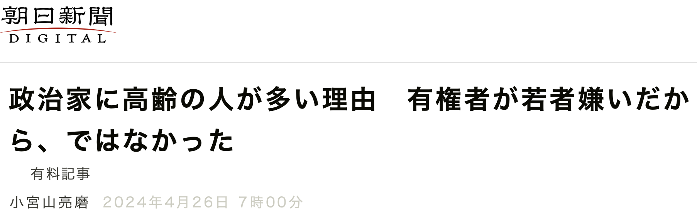

Today’s [Asahi Shimbun](https://digital.asahi.com/articles/ASS4S0TMYS4SULLI00NM.html?ptoken=01HWC7N5YQXSDMHHJ33BY8MVJZ) feature a story about my [Political Behavior](https://link.springer.com/article/10.1007/s11109-024-09920-2) article with Yoshikuni Ono.
