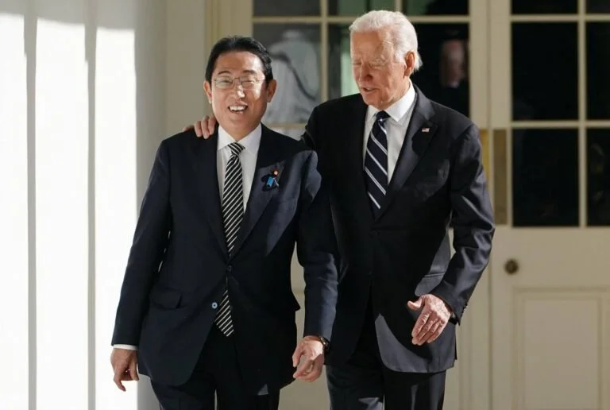

In our latest article for [Comparative Connections](https://cc.pacforum.org/2024/05/washington-welcomes-prime-minister-kishida/), Sheila Smith and I dive into the busy start of 2024 for US-Japan relations—from regional responses to Taiwan's election in January to the US-Japan and US-Japan-Philippines summits in April.
