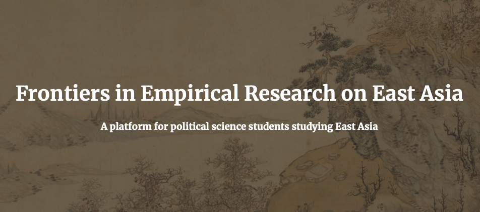

At this [NYU conference](https://sites.google.com/nyu.edu/ferea/home/ferea-2024?authuser=0), I presented new work (with Yuki Shiraito) on “Voter Preferences for Young and Female Candidates: Comparing Conjoint Experiments with Real-World Behavior.”
