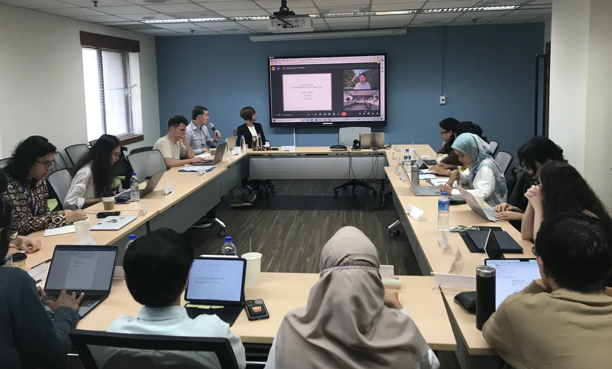

I discussed my [book project](/book-project) with a group of MA/PhD researchers participating in the [4th Asian Summer School on Political Parties and Democracy](https://democracyandparties.com/kas/wp-content/uploads/sites/7/2024/05/Handbook-Summer-School-2024.pdf) at National Chengchi University (NCCU) in Taipei.
