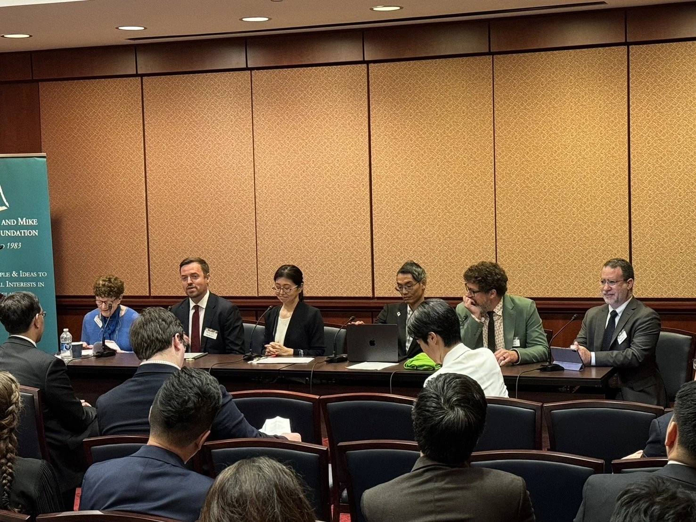

I visited Capitol Hill to discuss gerontocracy and youth representation as part of a Mansfield Foundation [U.S.-Japan Network for the Future](https://mansfieldfdn.org/program/strengthening-government-and-expert-networks/u-s-japan-network-for-the-future/) event.
