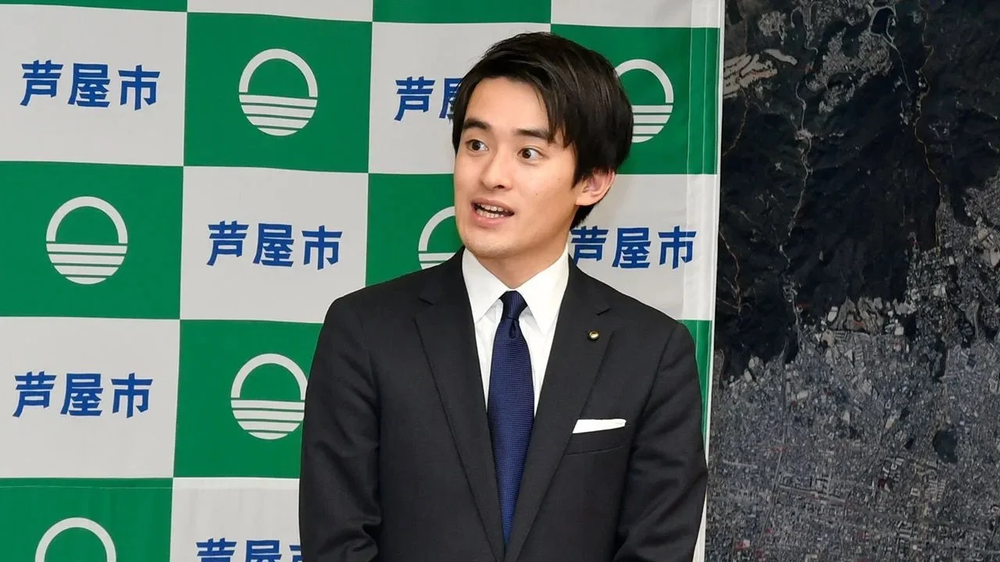

"Japan’s political system is not set up to reward the young." I shared insights from my research with [The Economist](https://www.economist.com/asia/2024/06/27/takashima-ryosuke-is-japans-youngest-ever-mayor) for their story on Takashima Ryosuke, Japan's youngest ever mayor, elected at 26.
