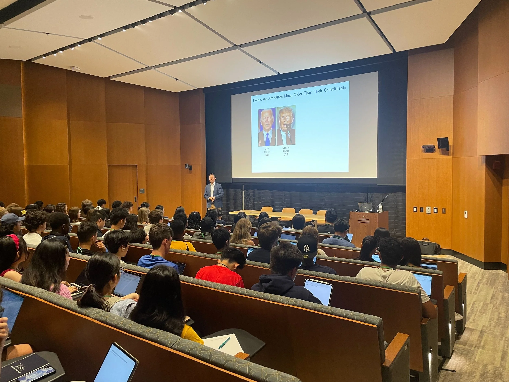

Today, I enjoyed giving a talk about youth representation for a great group of 150 high school students from 50+ countries, who are here participating in the [Yale Young Global Scholars](https://globalscholars.yale.edu) program. It was particularly nice to hear their thoughts about ways we can encourage more young people to run for office.
