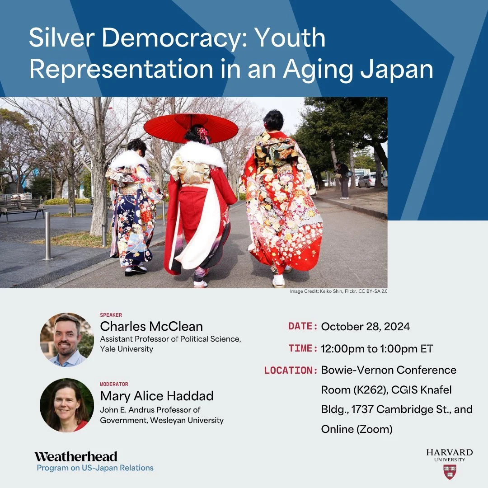

I visited Harvard University’s Program on U.S.-Japan Relations to discuss my [book project](/book-project) on youth representation and its impact on policymaking and democracy—just a day after Japan's election!
