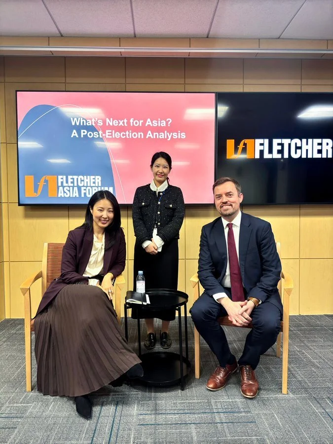

I was delighted to speak on a panel with Aram Hur for the newly launched [Fletcher Asia Forum’s](https://myfletcher.tufts.edu/fletcherconnect/rsvp_boot?id=2136591) first event at The Fletcher School of Law and Diplomacy at Tufts University. We shared insights from our research and discussed long-standing issues in East Asia that shape its democratic and diplomatic future with the United States.
