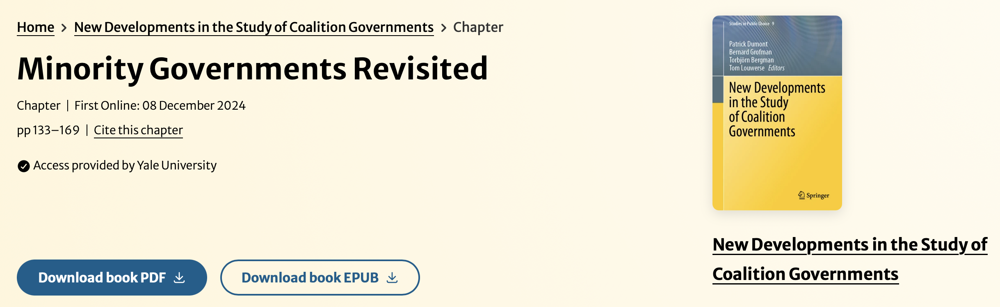

Kaare Strøm (UCSD) and I have a new book chapter out on [Minority Governments Revisited](https://link.springer.com/chapter/10.1007/978-3-031-69347-2_7)! The chapter is part of Patrick Dumont, Bernard Grofman, Torbjörn Bergman, and Tom Louwerse, eds. _New Developments in the Study of Coalition Governments_. Studies in Public Choice, vol 9. Springer, Cham.

**Abstract**

Despite decades of scholarship on coalition bargaining in parliamentary democracies, minority governments remain a puzzle. From the 1970s on, cross-national empirical scholarship has shown minority governments to be surprisingly common across parliamentary democracies. Even though scholarship that sought to explain identify the conditions that favored the formation minority governments developed, our knowledge still remains somewhat parochial. In this chapter we ask whether our existing understanding of minority governments can be generalized to more recent decades and to recent democracies of Central and Eastern Europe. We review existing explanations of the _incidence_ and _performance_ of minority governments and ask whether they still apply in this broader context. We find that minority governments tend to form under disproportional bargaining power, a larger number of parties in parliament, when the vote of investiture is not required, and when even opposition parties can expect to have policy impact. Next, we inspect the governance mechanisms that permit minority governments to retain power. Finally, our analysis of their performance shows that although less durable than other cabinet types, minority governments are remarkably successful at the polls. This comprehensive analysis and our robust findings across regions and periods contribute to the “normalization” of minority governments.
