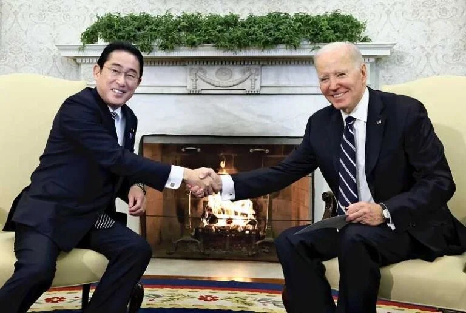

In our [latest article](https://cc.pacforum.org/2024/12/once-again-leadership-transitions-challenges-us-japan-alliance/) for Pacific Forum, Sheila Smith and I discuss Japan’s [snap election](https://journals.sagepub.com/doi/10.1177/0010414021997172) and Ishiba’s [minority government](https://link.springer.com/chapter/10.1007/978-3-031-69347-2_7); Trump’s return and its impact on US Indo-Pacific policy; and the expanding US-Japan regional and global agenda.
