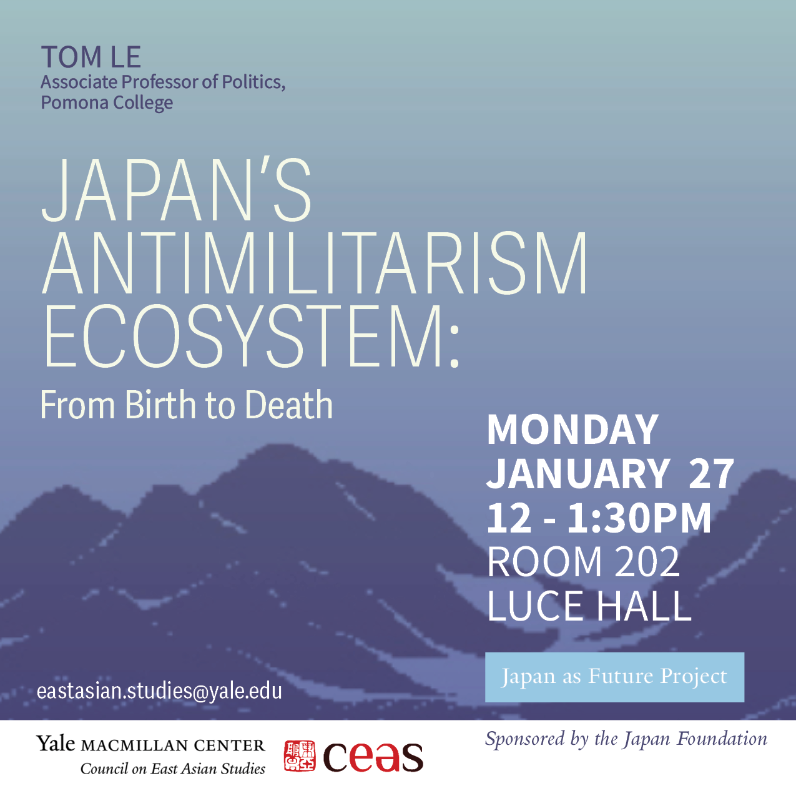
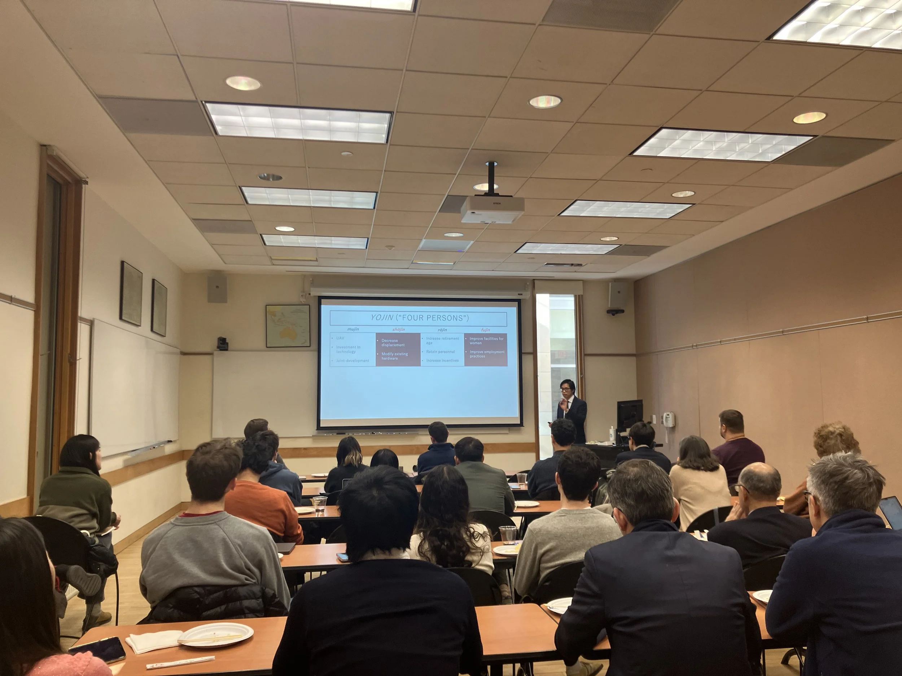

Great to kick off our new Japan as Future lecture series at Yale’s Council on East Asian Studies with [Tom Le (Pomona College)](https://www.pomona.edu/directory/people/tom-le)! He gave a [fantastic talk](https://macmillan.yale.edu/eastasia/events/2025-01-27/japans-antimilitarism-ecosystem-birth-death) on Japan’s “antimilitarism ecosystem” and how it constrains efforts to strengthen the Self-Defense Forces. For more information, check out Tom’s [book](https://cup.columbia.edu/book/japans-aging-peace/9780231199797), which dives deeper into these themes.
