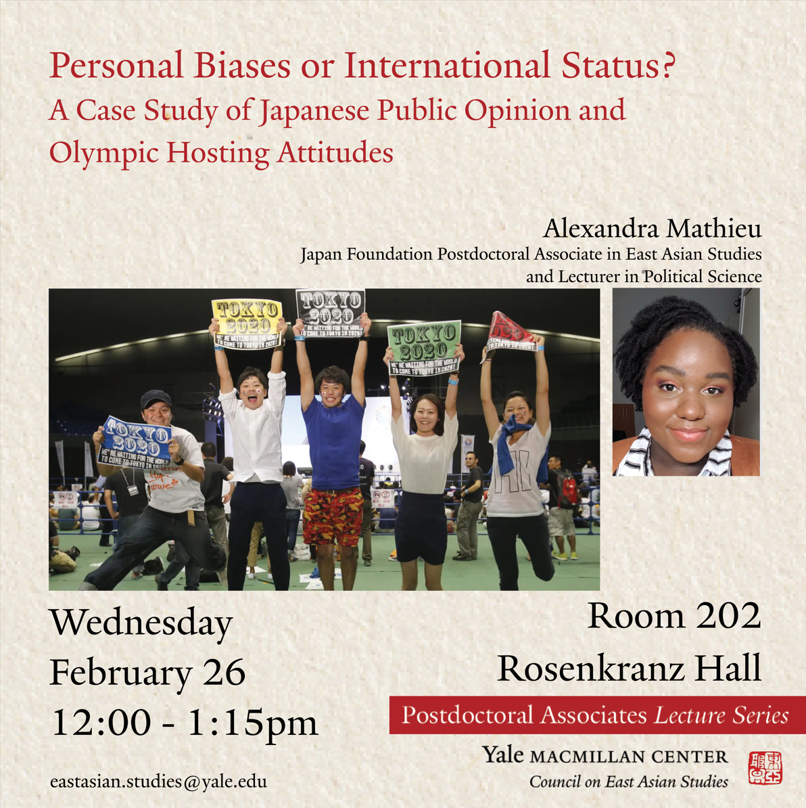

On February 26, I was delighted to chair a talk featuring our Japan Foundation Postdoctoral Associate Alexandra Mathieu. She shared her fascinating work on how personal biases and international status concerns shape public preferences in Japan.
