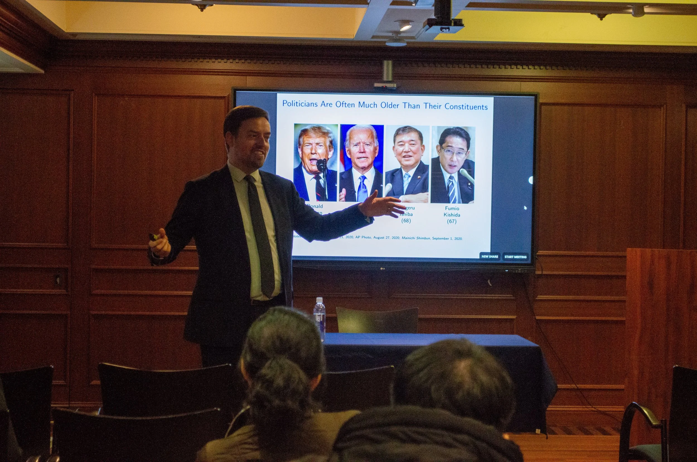

On February 27, I had a great time discussing my [book project](/book-project) at the Asian Studies Program in Georgetown’s Walsh School of Foreign Service. Grateful to everyone who came for their questions and feedback, and special thanks to Trevor Incerti for the invitation.
