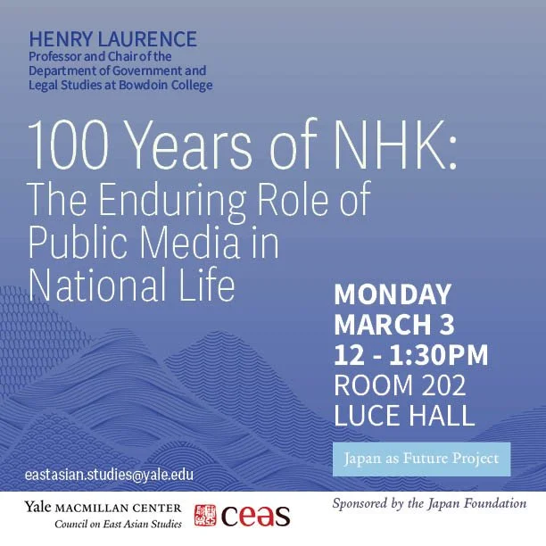
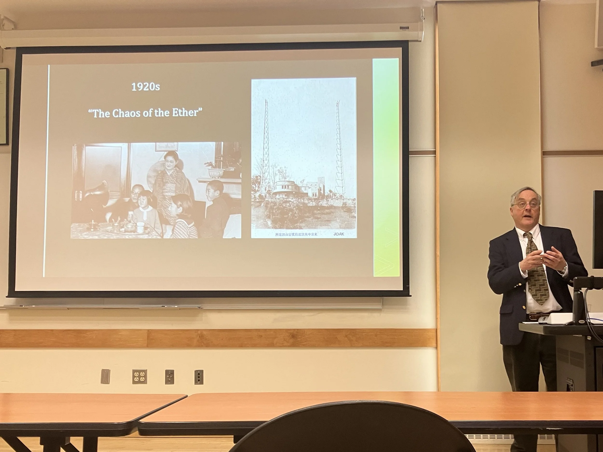

For the second talk in our Japan as Future lecture series, I was delighted to host [Henry Laurence (Bowdoin College)](https://www.bowdoin.edu/profiles/faculty/hlaurenc/index.html). He gave a [fascinating talk](https://macmillan.yale.edu/eastasia/events/2025-03-03/100-years-nhk-enduring-role-public-media-national-life) about the politics of public broadcasting in Japan and Britain, comparing NHK with the BBC. For more on this topic, check out Henry’s [recent book](https://www.routledge.com/The-Politics-of-Public-Broadcasting-in-Britain-and-Japan-The-BBC-and-NHK-Compared/Laurence/p/book/9781032310398?srsltid=AfmBOoraPGCEDRXeSsUYj7ZT_HG1r6lkdjP18x6qc5RvndHJH_o0Gbv1).
