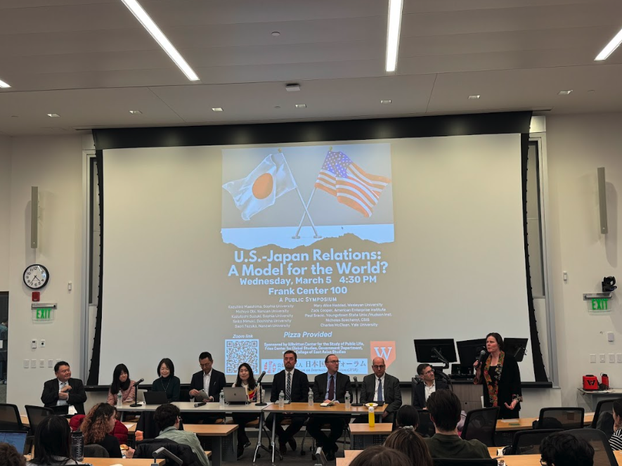

I visited Wesleyan University to join this great symposium on deepening U.S.-Japan ties beyond security. I discussed my [book’s](/book-project) focus on gerontocracy and the struggle to get young people involved in politics—key challenges for both countries. Thanks to everyone who joined!
