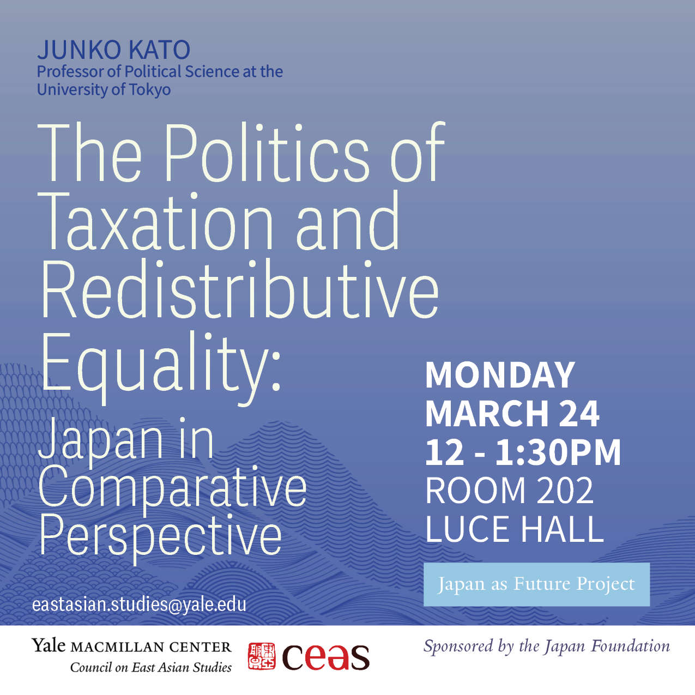
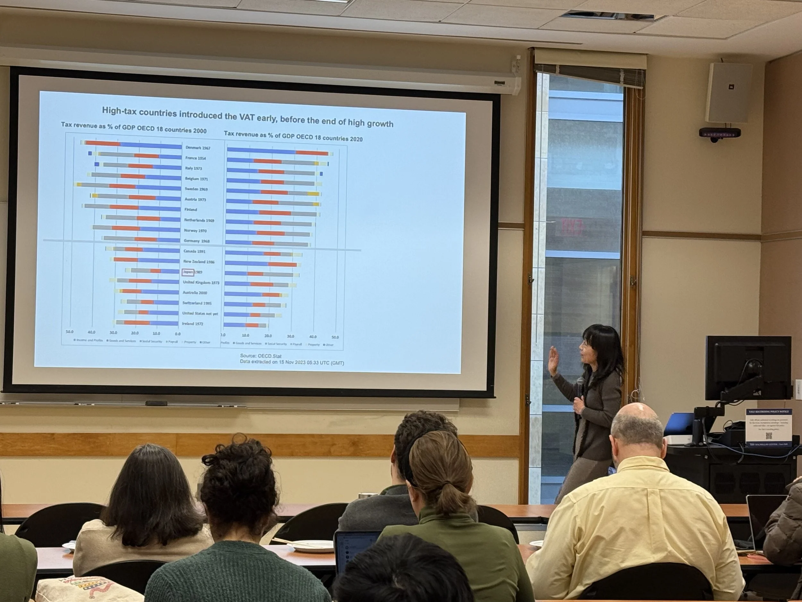

For the third event in our Japan as Future lecture series, I was delighted to host [Junko Kato](http://www.katoj.j.u-tokyo.ac.jp) (University of Tokyo) for a [talk](https://macmillan.yale.edu/eastasia/events/2025-03-24/politics-taxation-and-redistributive-equality-japan-comparative) on taxation, redistribution, and the politics of Japan’s welfare state.
