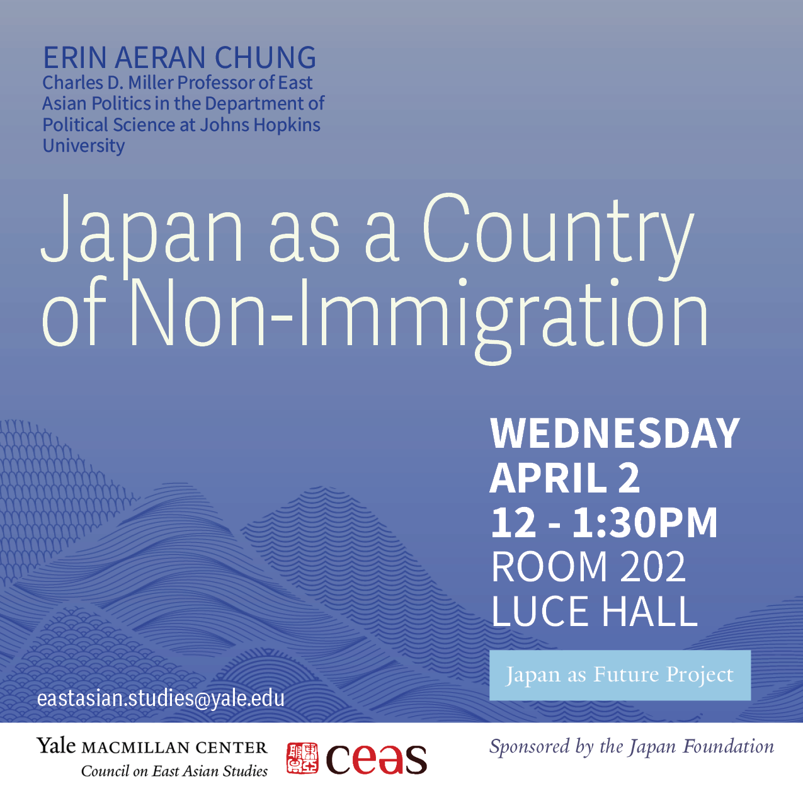
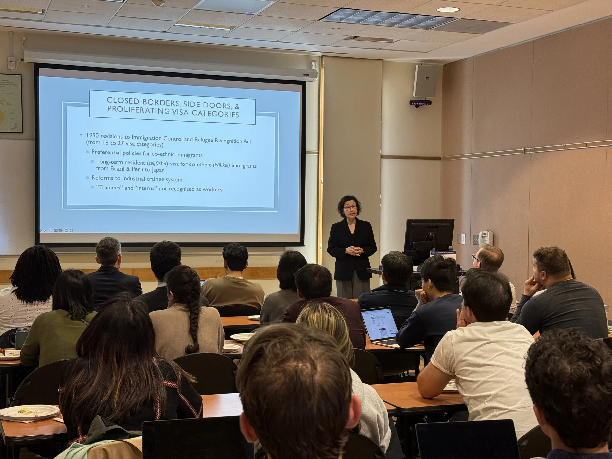

For the fourth event in our Japan as Future lecture series, I was delighted to host [Erin Aeran Chung](https://politicalscience.jhu.edu/directory/erin-aeran-chung/) (Johns Hopkins University) for a discussion on how Japan’s [model of immigration control](https://macmillan.yale.edu/eastasia/events/2025-04-02/japan-country-non-immigration) is increasingly becoming the norm globally.
