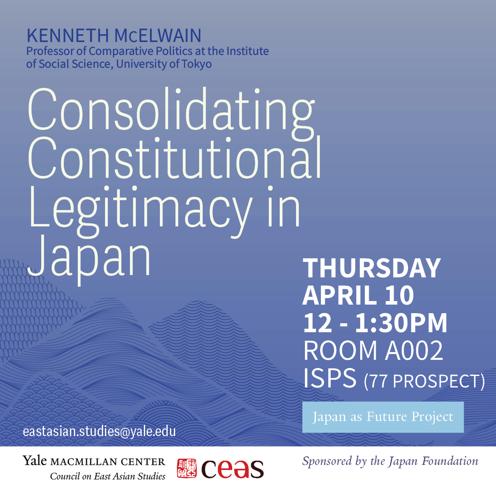
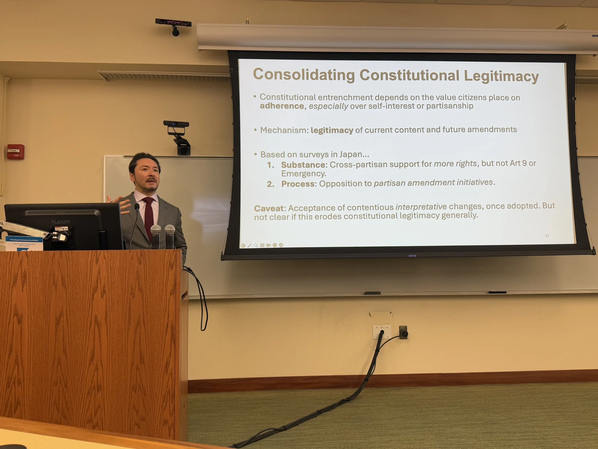

For the final event in our Japan as Future lecture series, [Kenneth McElwain](https://www.kennethmcelwain.com) (University of Tokyo) joined us to discuss his work on [public attitudes toward constitutional revision](https://macmillan.yale.edu/eastasia/events/2025-04-10/consolidating-constitutional-legitimacy-japan) and their implications for democratic governance.
