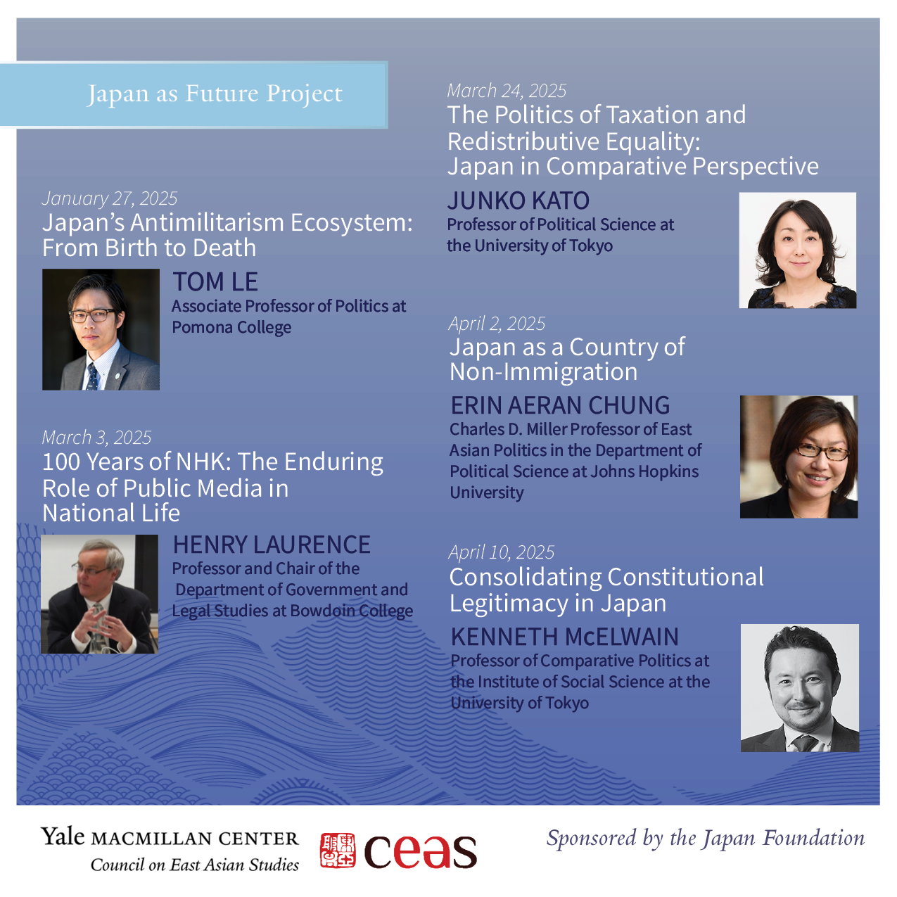

Thank you to our five speakers for joining this year’s Yale [MacMillan Center](https://macmillan.yale.edu) [CEAS](https://macmillan.yale.edu/eastasia) Japan as Future series! Special thanks as well to our postdoc, [Alex Mathieu](https://macmillan.yale.edu/eastasia/person/alexandra-mathieu), for all her help organizing the series—and to the [Japan Foundation](https://www.jpf.go.jp/e/) for their generous support!
