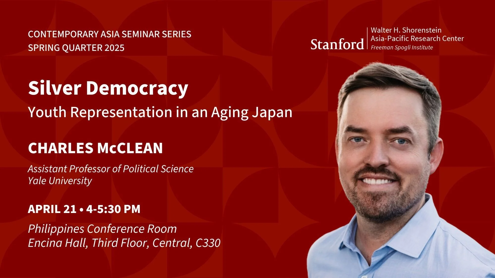

I greatly enjoyed visiting Stanford’s [Shorenstein Asia-Pacific Research Center,](https://aparc.fsi.stanford.edu) a part of the [Freeman Spogli Institute for International Studies](https://fsi.stanford.edu), to [discuss](https://aparc.fsi.stanford.edu/events/silver-democracy-youth-representation-aging-japan) my [book project](/book-project) on youth representation and its implications for policymaking and democracy.
