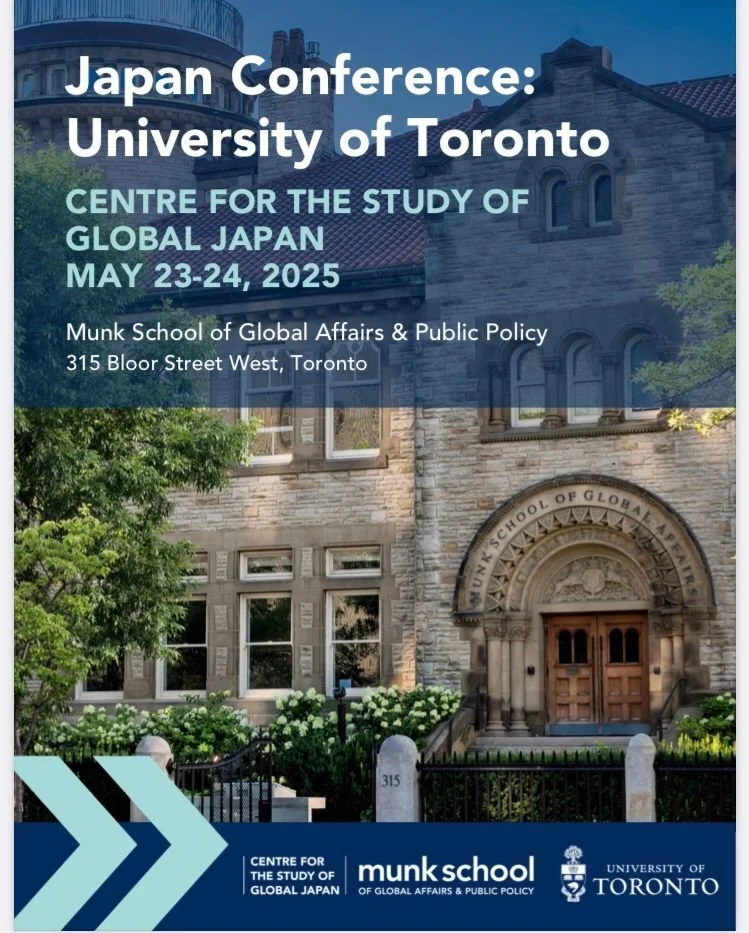

I was delighted to participate in this inaugural conference on Japan hosted by [Phillip Lipscy](https://www.lipscy.org) at the University of Toronto’s [Centre for the Study of Global Japan](https://munkschool.utoronto.ca/csgj). The plan is for us to host the second conference here at Yale, so stay tuned for more details!
