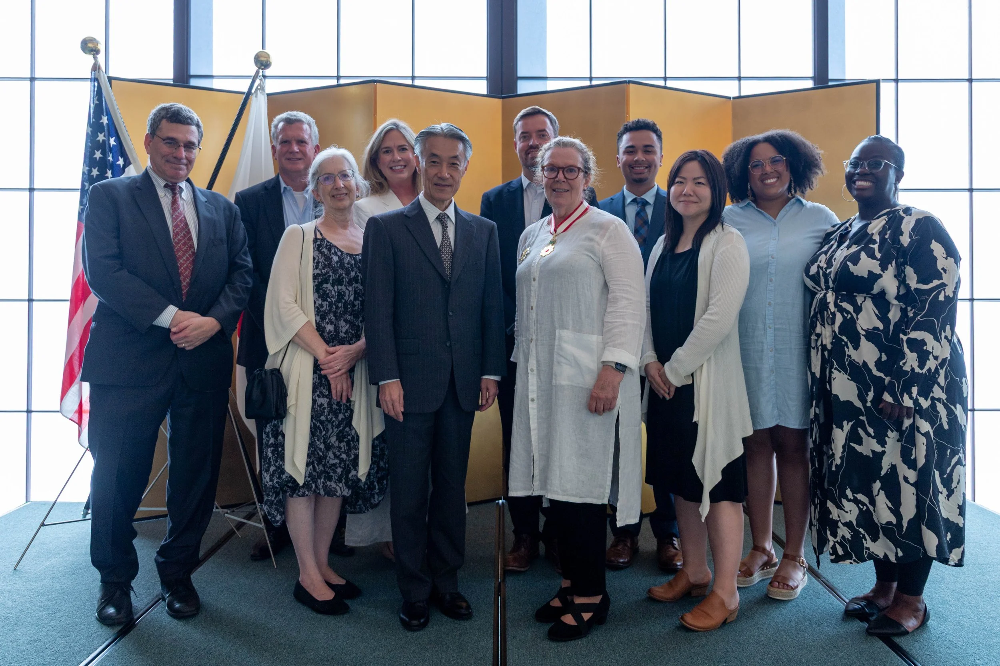

A truly special evening at the residence of Japanese Ambassador to the United States Shigeo Yamada, honoring [Sheila Smith](https://www.cfr.org/expert/sheila-smith) and her conferral of the Order of the Rising Sun, Gold and Silver Star, for her decades of contributions to the U.S.-Japan Relationship. I’m so grateful to Sheila for being such a generous and inspiring mentor over the years.
