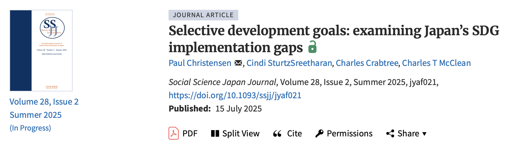

Paul Christensen, Cindi SturtzSreetharan, Charles Crabtree, and I have a new article out in [Social Science Japan Journal](https://academic.oup.com/ssjj/article/28/2/jyaf021/8202164).

**Abstract**

In this article, we consider how efforts by the Japanese government and private sector to make the United Nations’ Sustainable Development Goals (SDGs) prominent and pervasive reveal obfuscation around issues and concerns purportedly being addressed. We examine three specific components of the SDGs: no poverty, zero hunger, and gender equality. In doing so, we demonstrate a disjuncture between official proclamations endorsing an SDG agenda and ethnographic observations that illustrate the hollowness of these efforts. We argue that the SDGs, a repository of lofty and aspirational goals, many of which are arguably necessary for planetary health and collective well-being, are used by the Japanese government as an instrument of techno-political effect to obscure root causes of persistent societal issues. The result of which nurtures and perhaps sustains insufficient social, political, and structural changes throughout Japan.
