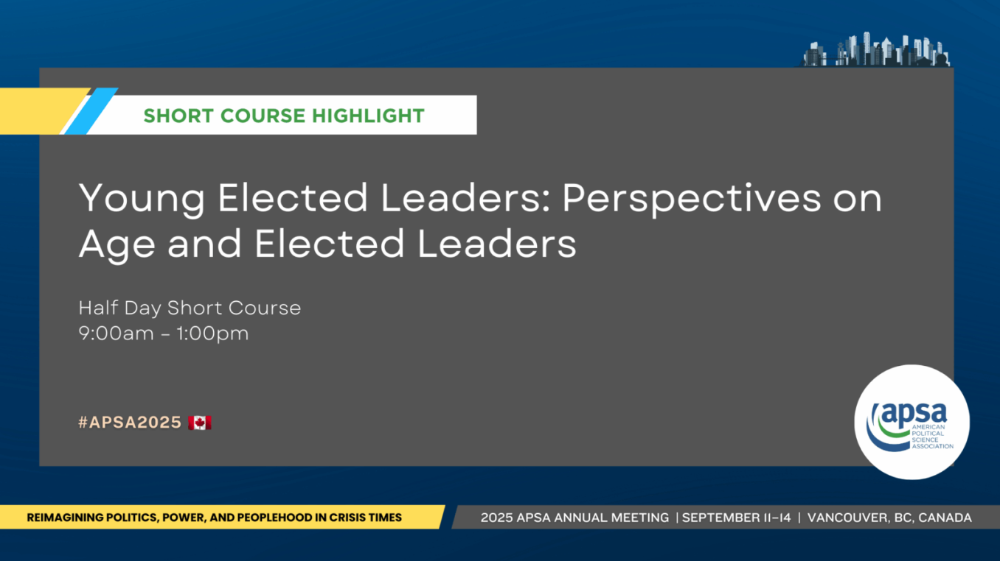

At APSA 2025 in Vancouver, I presented new work with [Aksel Sundstrom](https://akselsundstrom.com) and [Daniel Stockemer](https://uniweb.uottawa.ca/network/profile/members/860) as part of the short course on [Young Elected Leaders: Perspectives on Age and Elected Leaders](https://politicalsciencenow.com/short-course-young-elected-leaders-perspectives-on-age-and-elected-leaders/). We find evidence that boosting youth representation can increase perceptions of fairness, decision quality, and trust in democratic institutions. An [earlier draft](https://www.gu.se/sites/default/files/2024-09/2024_6_Sundstrom%20et%20al.pdf) of our manuscript is available online, but we’re looking forward to sharing the updated paper soon!
