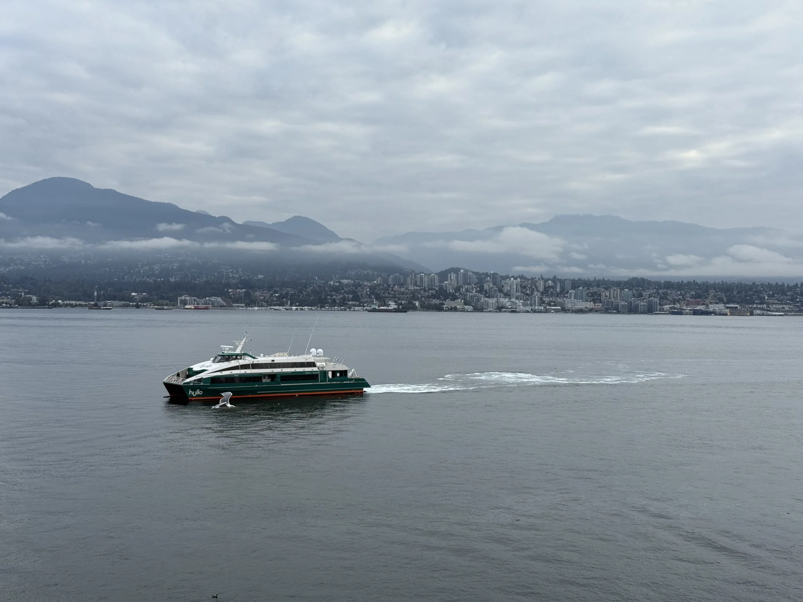

At APSA 2025 in Vancouver, [Kentaro Fukumoto](https://sites.google.com/g.ecc.u-tokyo.ac.jp/kentarofukumoto/) and I presented a new paper. In Japanese municipal assembly elections, ties sometimes occur; in such cases, the winner is determined by lottery. We show that the incumbency effects estimated from lottery elections are different from those estimated by RDD. We’re looking forward to sharing a working paper soon!
