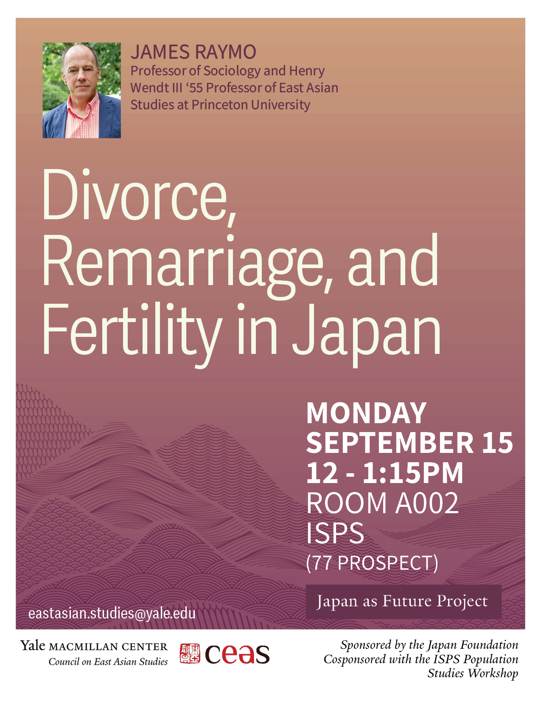

Delighted to welcome [James Raymo](https://sociology.princeton.edu/people/james-raymo) (Princeton) to Yale today to kick off two series:

-   Launch of the [Population Studies Workshop](https://isps.yale.edu/population-studies-workshop) at ISPS
    
-   New year of our [Japan series](https://macmillan.yale.edu/eastasia/events/2025-09-15/divorce-remarriage-and-fertility-japan) at Yale MacMillan CEAS
    

His [talk](https://isps.yale.edu/events/2025/09/divorce-remarriage-and-fertility-in-japan-james-raymo-princeton-university) focuses on divorce, remarriage, and fertility in Japan.
