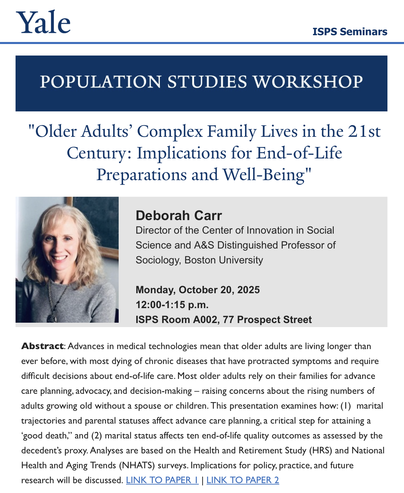

For the next talk in our [Population Studies Workshop](https://isps.yale.edu/population-studies-workshop), we’re delighted to welcome [Deborah Carr](https://isps.yale.edu/events/2025/10/older-adults-complex-family-lives-in-the-21st-century-implications-for-end-of-life) (Boston University) on October 20.
