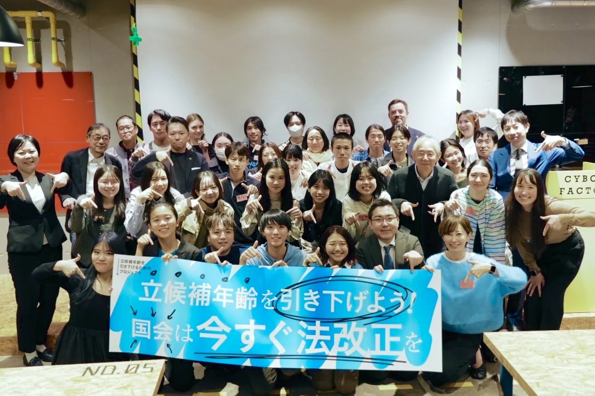

Grateful for the opportunity to join [Youthful Democracy Project](https://hikisage.jp) at the Tokyo District Court on October 24. While they lost the case to lower Japan’s age of candidacy to 18, their continued efforts to make politics more accessible to young people are truly inspiring.
