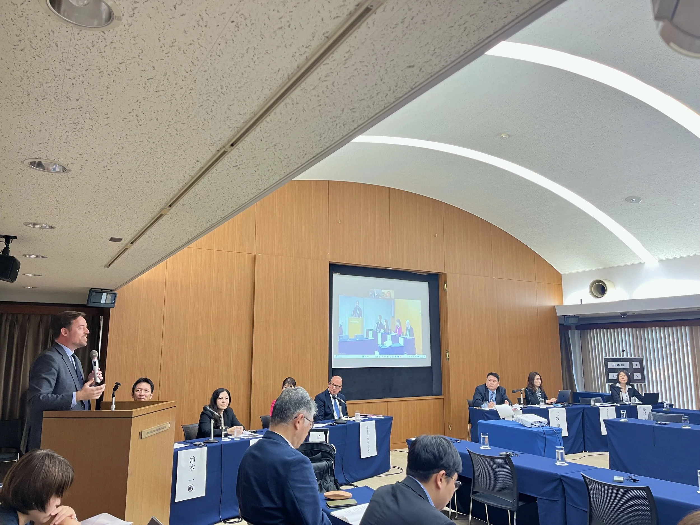

I spoke about insights from my [book project](/book-project) as part of a [Japan Forum on International Relations](https://www.jfir.or.jp/en/) symposium on the future of U.S.-Japan relations in the Trump 2.0 era, held at the International House of Japan in Tokyo.
