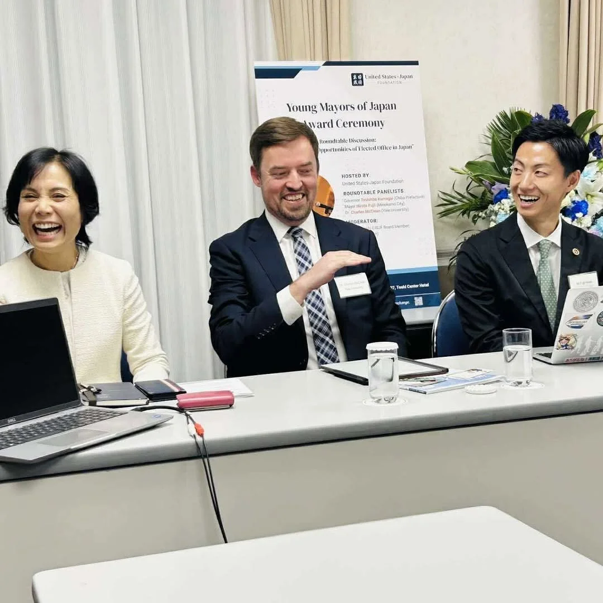

Congratulations to Mayor Hiroto Fujii on being the inaugural recipient of the U.S.-Japan Foundation [Young Mayors of Japan Award](https://us-jf.org/en/news/hiroto-fujii-of-minokamo-city-receives-usjf-young-mayors-of-japan-award)—recognizing Japan’s next generation of local leaders.

I was honored to serve on the selection committee alongside Lin Kobayashi and Chiba Governor Toshihito Kumagai.

At the award ceremony in Tokyo, I spoke about my [book project](/book-project) and joined a discussion with Lin Kobayashi and Mayor Fujii on the future of local governance.
