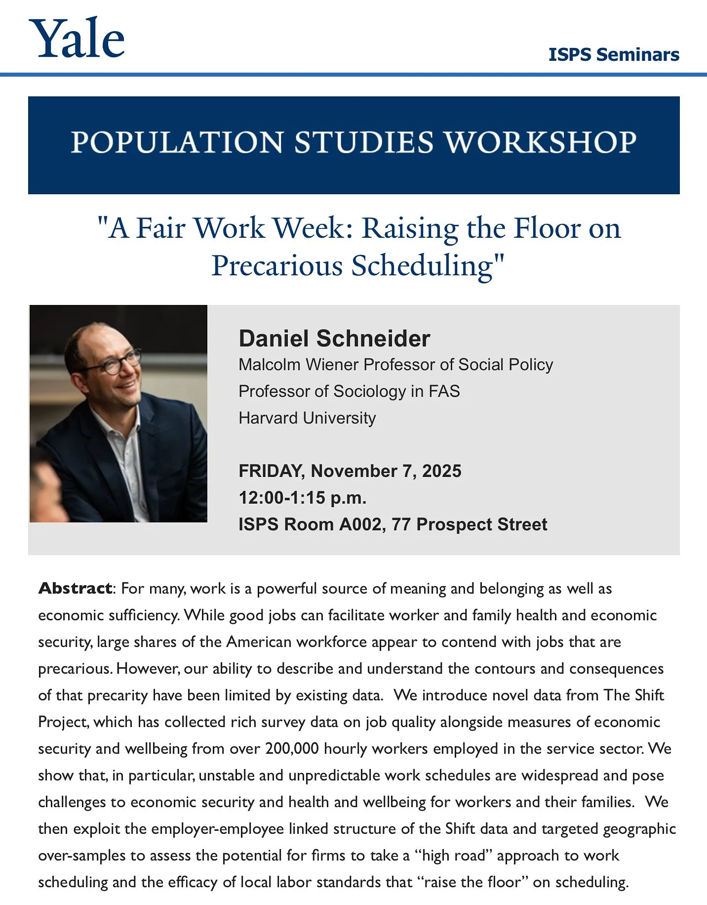

[Daniel Schneider](https://www.hks.harvard.edu/faculty/daniel-schneider) (Harvard Kennedy School, Harvard Department of Sociology) joined us for the latest talk in our [Population Studies Workshop](https://isps.yale.edu/population-studies-workshop). He spoke about his fascinating research at [The Shift Project](https://shift.hks.harvard.edu) on schedule unpredictability at work, the challenges it poses for economic security, and the consequences for the health and wellbeing of workers and their families.
