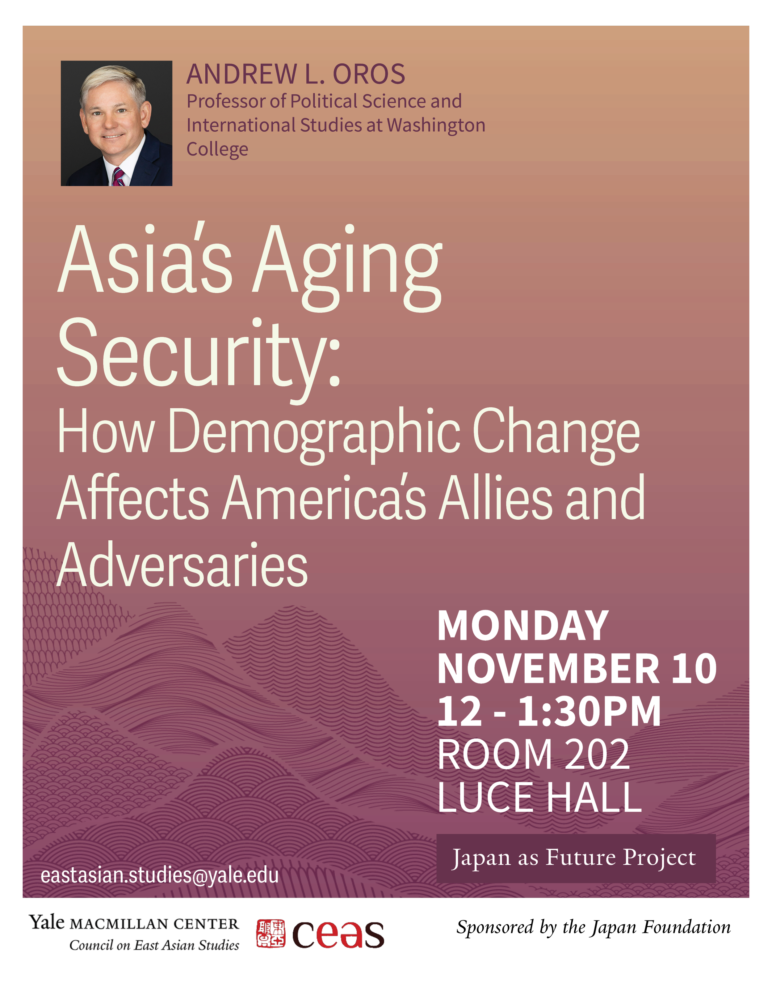

For the latest [talk](https://macmillan.yale.edu/eastasia/events/2025-11-04/asias-aging-security-how-demographic-change-affects-americas-allies-and) in our Japan as Future series, [Andrew Oros](https://www.washcoll.edu/people_departments/faculty/aoros2.php) (Washington College, The Stimson Center) joined us to talk about his exciting new book on [Asia’s Aging Security](https://cup.columbia.edu/book/asias-aging-security/9780231205610/).
