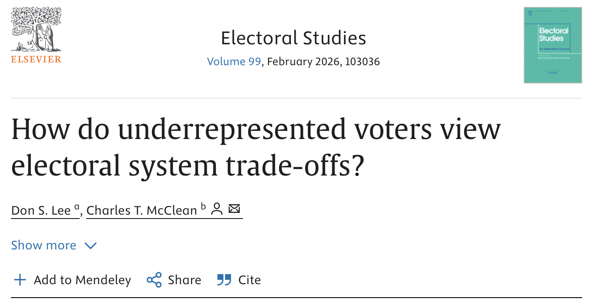

Don Lee and I have a new, [open-access article](https://www.sciencedirect.com/science/article/pii/S0261379425001428) out in Electoral Studies!

**Abstract**

Scholars of electoral reform have long debated the trade-off between accountability and representation in majoritarian versus proportional systems, yet few have examined how voters themselves view this trade-off. We argue that voters who have historically lacked political voice, such as women and young people, are more likely to favor reforms that expand representation, even at some cost to accountability. We test this argument using a conjoint experiment conducted before South Korea’s 2020 election—a moment marked by intense public debate over whether the government should implement electoral reforms to enhance representation or accountability. Our findings show that while women and younger voters lean toward more representative rules, they also value accountability and resist certain reforms that would weaken it. This preference for representation is stronger when considering major electoral system changes rather than minor rule adjustments and is especially pronounced among independent or minor party supporters compared to major party supporters. These insights have important implications for our understanding of electoral reform, voter preferences, and the political inclusion of underrepresented groups.
