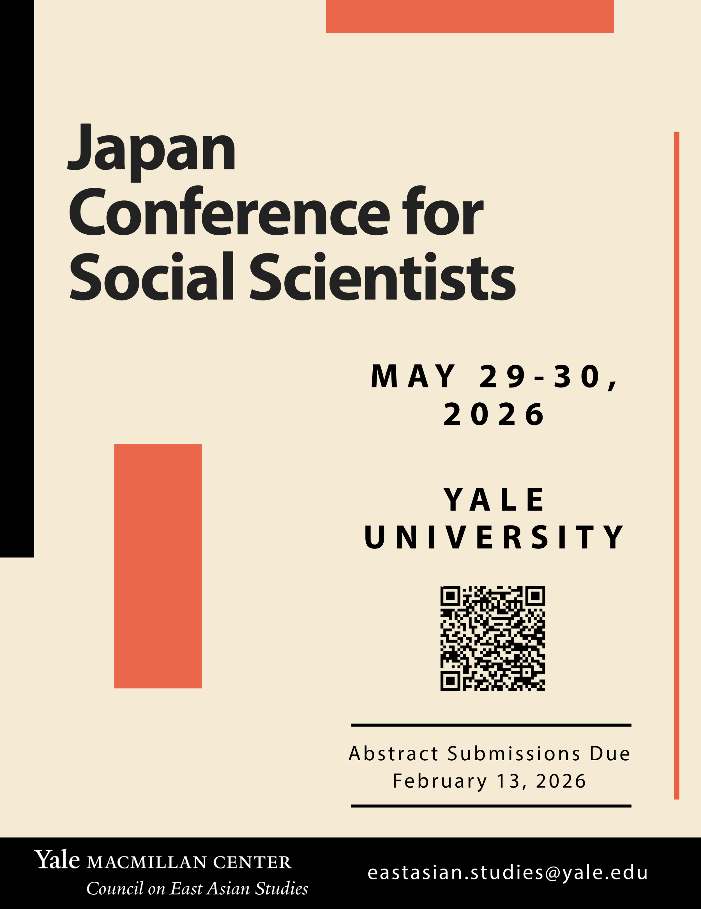

Anna Yorozuya and I are delighted to host the second annual [Japan Conference for Social Scientists](https://macmillan.yale.edu/eastasia/events/2026-05-29/japan-conference-social-scientists) at Yale from May 29-30, 2026. Abstract submissions are due February 13. Hope you can join us!
