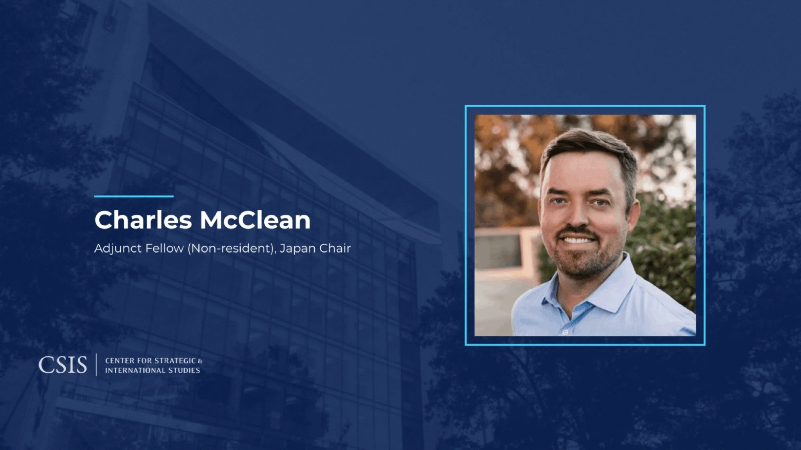

I’m delighted to share that I’ve accepted an affiliation as an Adjunct Fellow (Non-Resident) with the [Japan Chair](https://www.csis.org/programs/japan-chair) at the [Center for Strategic and International Studies](https://www.csis.org).
