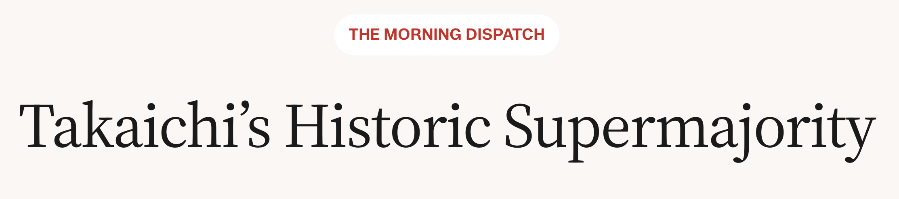

I was [quoted](https://thedispatch.com/newsletter/morning/takaichis-historic-supermajority/) in The Dispatch on Takaichi’s unusually strong support among younger voters—and what that meant for the LDP going into Japan’s snap election.
