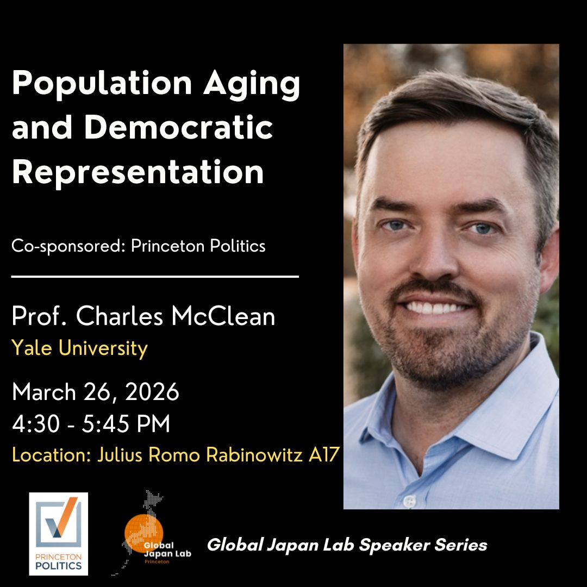

Thank you to Jim Raymo, the [Global Japan Lab](https://gjl.princeton.edu/), and Princeton Politics for hosting me to present new research with Michael Strausz on population aging and democratic representation. Really appreciated the great conversation and thoughtful comments.
