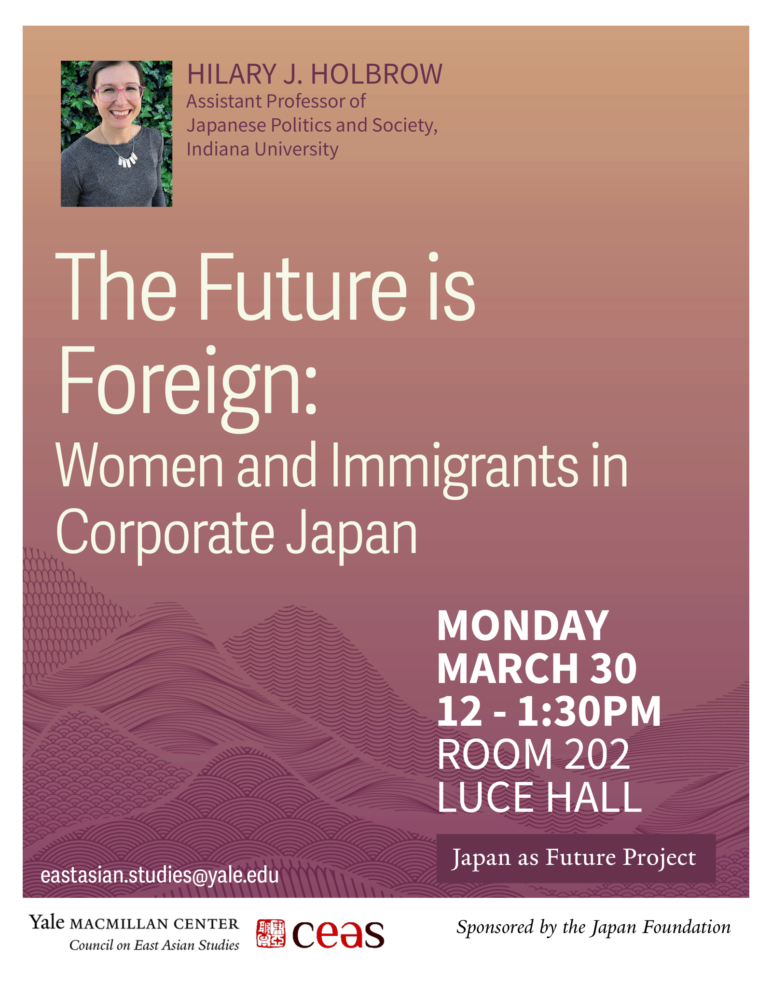

Delighted to welcome Hilary Holbrow (Indiana University) as the next speaker in our Japan as Future series at the Yale MacMillan Center. She discussed her new book, The Future is Foreign: Immigrants and Women in Corporate Japan, and her finding that in Japan's white-collar workplaces gender is a far sharper axis of inequality than foreign origin.
