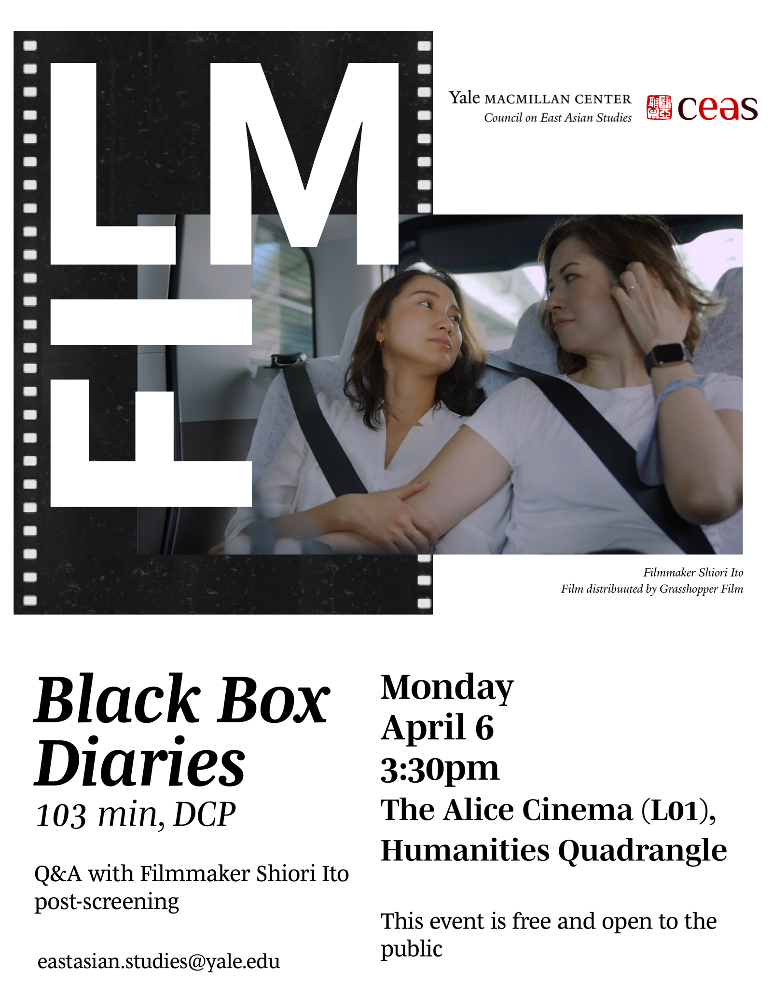

For the final event in this year's Japan as Future series at the Yale MacMillan Center, journalist and filmmaker Shiori Ito joined us for a screening of her Oscar-nominated documentary, Black Box Diaries, followed by a Q&A. Thank you to Shiori and to everyone who filled the room.
