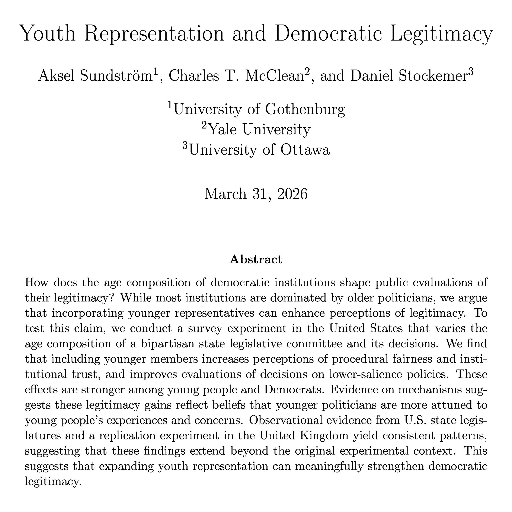

Happy to share that my paper with Aksel Sundström and Daniel Stockemer, [Youth Representation and Democratic Legitimacy](/s/Youth-Representation-and-Democratic-Legitimacy.pdf), has won the [SPPQ Best Paper Award](https://www.uottawa.ca/en/news-all/professor-daniel-stockemer-wins-best-paper-award-journal-state-politics-policy-quarterly) from APSA's State Politics and Policy section. We find including younger representatives in decision-making bodies can boost perceptions of fairness and institutional trust.
