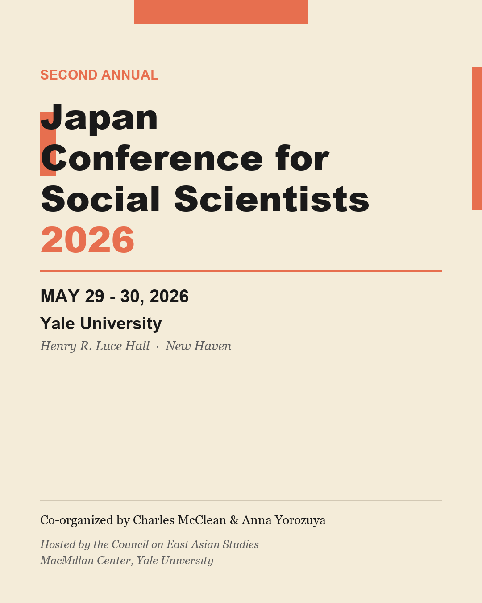

Anna Yorozuya and I hosted the second annual [Japan Conference for Social Scientists](https://macmillan.yale.edu/eastasia/events/2026-05-29/japan-conference-social-scientists) at Yale on May 29–30, with support from the Council on East Asian Studies and the Japan Foundation. Six panels brought together 17 presenters and six discussants working on Japan across the social sciences. Thank you to everyone who made the trip to New Haven.
