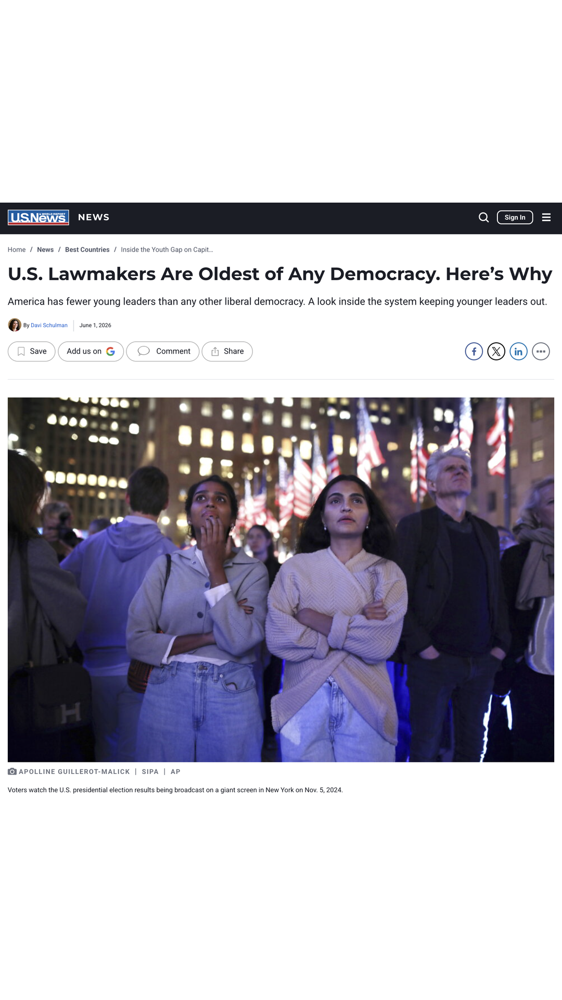

A [U.S. News](https://www.usnews.com/news/best-countries/articles/2026-06-01/u-s-lawmakers-are-oldest-of-any-democracy-heres-why) story, "U.S. Lawmakers Are Oldest of Any Democracy. Here's Why," cited my paper with Aksel Sundström and Daniel Stockemer (both quoted) on [youth representation and democratic legitimacy](/s/Youth-Representation-and-Democratic-Legitimacy.pdf).
