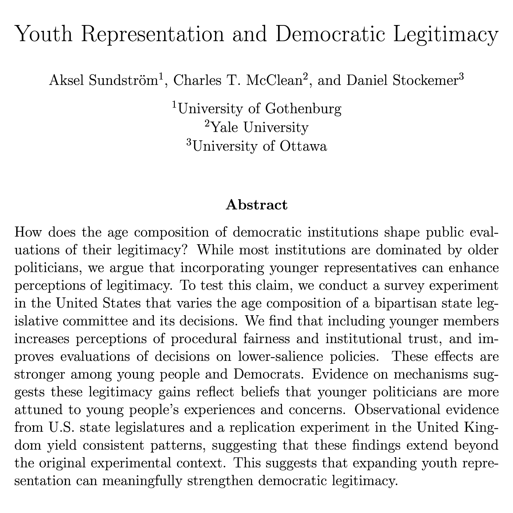

Second piece of good news: my paper with Aksel Sundström and Daniel Stockemer, [Youth Representation and Democratic Legitimacy](/s/Youth-Representation-and-Democratic-Legitimacy.pdf), is now forthcoming at the British Journal of Political Science. We find that including younger representatives in decision-making bodies can boost perceptions of fairness and trust, even among older adults.
