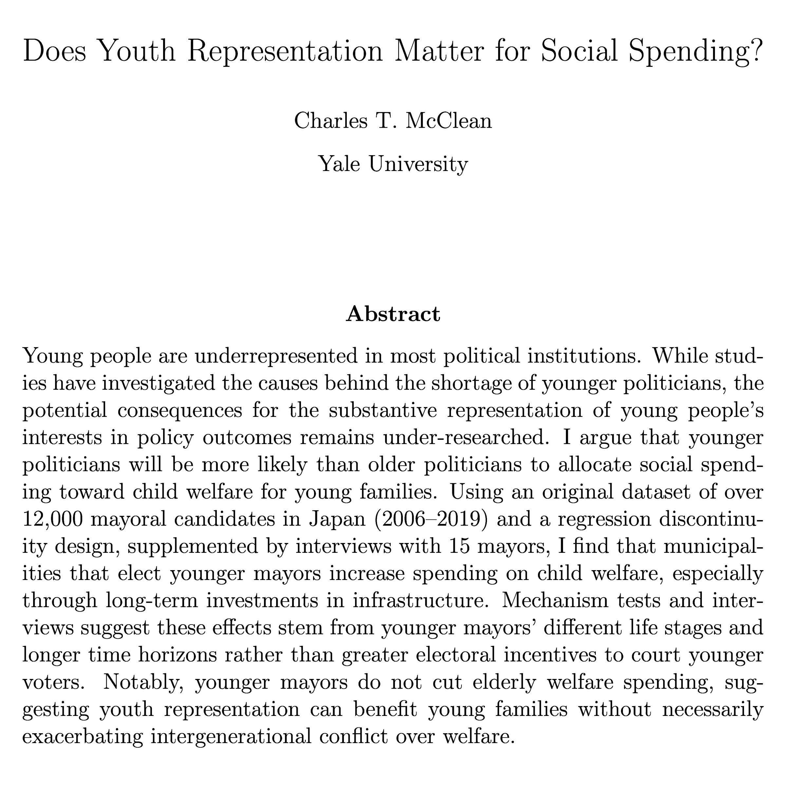

Happy to share two pieces of good news. First, my job market paper, [Does Youth Representation Matter for Social Spending?](https://www.journals.uchicago.edu/doi/10.1086/741605), is online at the Journal of Politics. I find younger mayors increase spending on child welfare for young families, especially through long-term investments, but do not cut elderly welfare spending.
