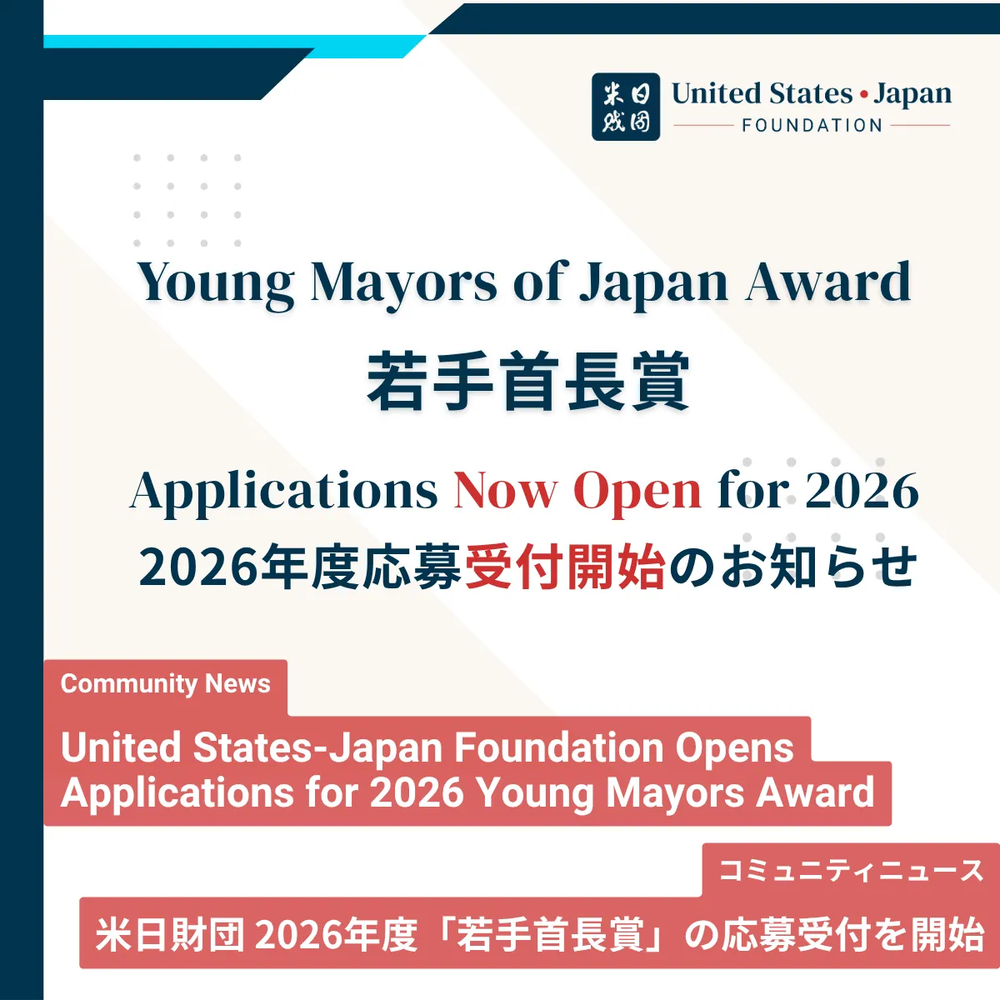

Delighted to serve again on the selection committee for the [U.S.-Japan Foundation](https://us-jf.org/en/) Young Mayors of Japan Award alongside Governor Toshihito Kumagai and Lin Kobayashi. [Applications are now open](https://us-jf.org/en/news/united-states-japan-foundation-opens-applications-for-2026-young-mayors-award) for the 2026 award.

2026年度「若手首長賞」の応募受付が始まりました。若手首長の皆さま、ぜひご応募ください。
